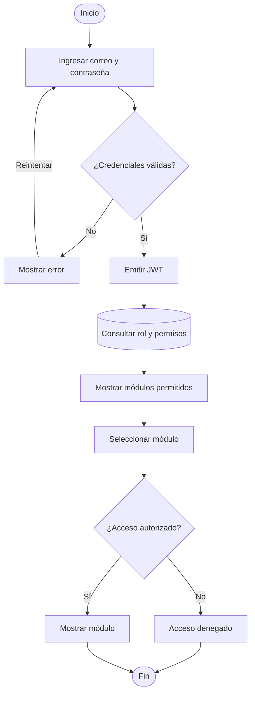
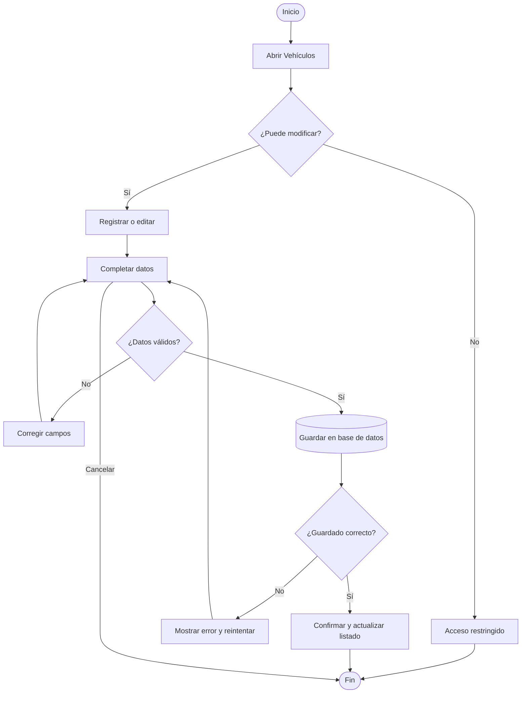
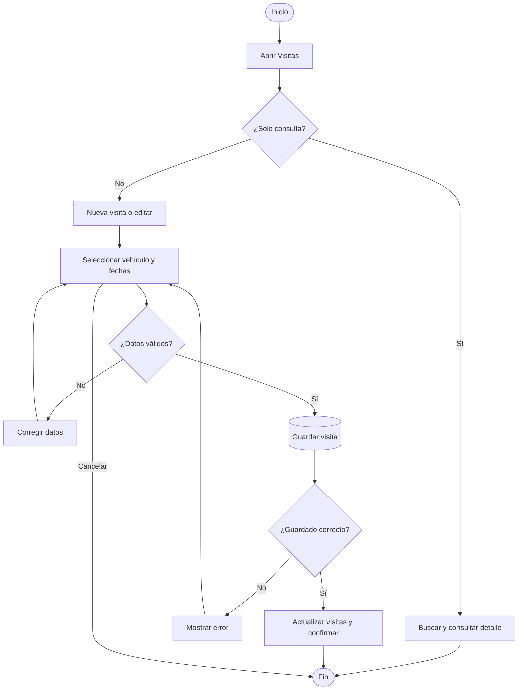
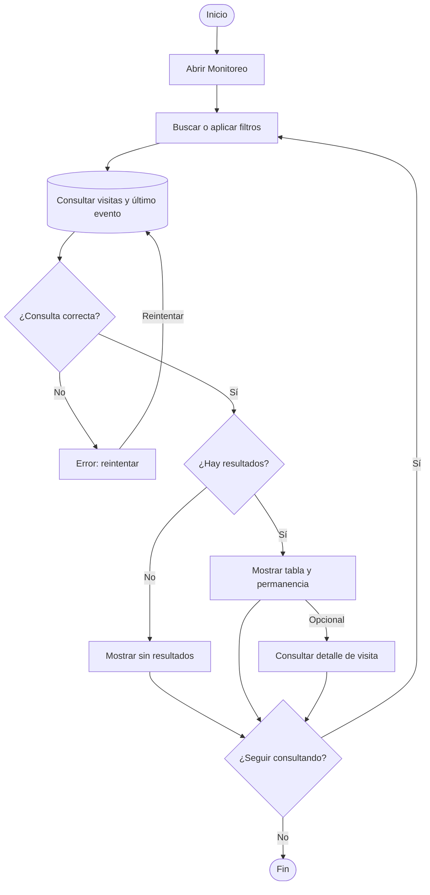
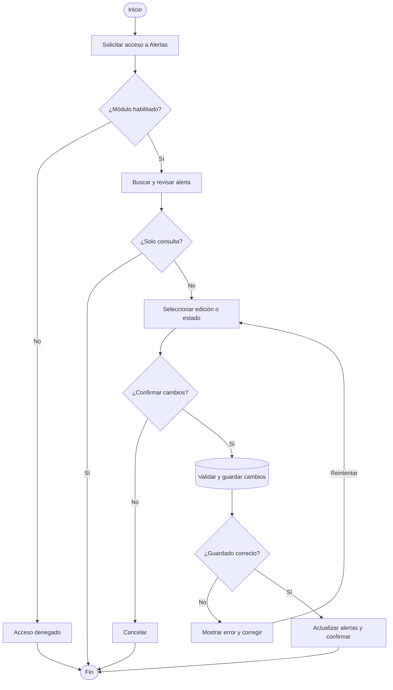

# Diagramas de flujo de los cinco procesos principales

Estos diagramas describen la aplicación actual. Los permisos efectivos dependen de `modulo_x_rol`; los roles de solo consulta no pueden modificar registros. No se modificaron datos ni código de la aplicación para elaborarlos.

Abre `DIAGRAMAS_FLUJO_PROCESOS.drawio` en diagrams.net: contiene una página por proceso. Este documento también incluye los diagramas en Mermaid.

## 1. Autenticación y acceso por rol

**Participantes:** administrador, operador y supervisor.

La sesión usa JWT. Los módulos se obtienen de modulo_x_rol y supervisor conserva solo consulta.

## 2. Registro y actualización de vehículos

**Participantes:** administrador y operador con acceso a Vehículos.

Proceso de registro y edición. El botón Eliminar queda bloqueado si hay visitas; el backend local conserva el registro al desactivarlo.

## 3. Registro y consulta de visitas

**Participantes:** administrador y operador gestionan; supervisor consulta.

El formulario actual solicita vehículo, fecha de entrada y fecha de salida. La eliminación no se ofrece en la interfaz.

## 4. Monitoreo y consulta vehicular

**Participantes:** administrador, operador y supervisor con acceso a Monitoreo.

Consulta datos registrados; no representa detección de cámaras ni generación automática de alertas. La actualización cada 30 s es opcional y se pausa al interactuar.

## 5. Consulta y gestión de alertas

**Participantes:** administrador gestiona; supervisor consulta; operador sin acceso por defecto.

Se representan las consultas, edición y activación/desactivación disponibles. No se inventa un proceso de resolución automática.

